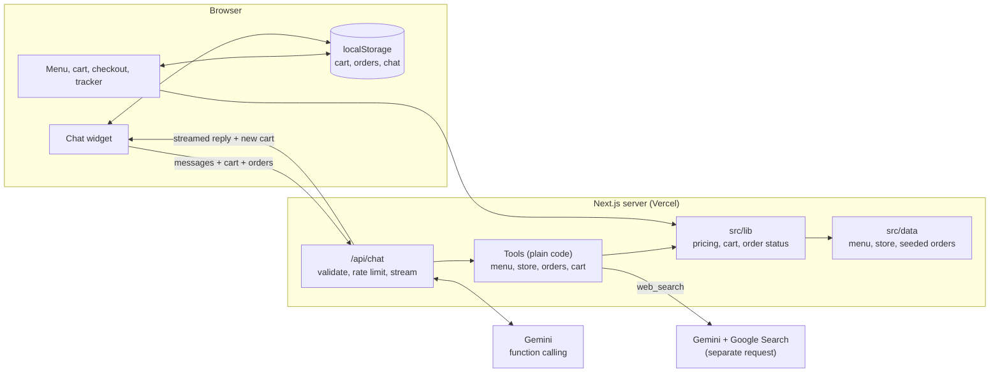

# US Pizza Demo: food ordering website with an AI assistant

> **Demo with dummy data.** This is an assessment project, not an official US Pizza website. No real orders are taken and no payment is collected.

**Live demo:** _coming soon (link to be added after deployment)_

## 1. What this is, in plain English

A small pizza ordering website, using made-up menu and order data, with an AI assistant built in. You can browse the menu, choose a pizza size and crust, fill a cart, check out (no real payment), and watch a pretend order move from "Order received" to "Delivered".

The assistant sits in the corner of every page. It can answer questions about the menu, allergens, delivery, refunds and your orders. It can add items to your cart or remove them. It can look up live information on the web, such as the weather, and it can answer general questions too.

The main design idea: **AI handles language, normal code handles facts.** The AI decides *what the customer is asking for*. Every price, total and order status comes from ordinary, tested code, so the assistant cannot make up a price or change one.

## 2. Features

**Ordering**
- Menu with 20 items in 5 categories, original illustrations, dietary tags and allergens
- Pizza options: Regular or Large, and Hand-Tossed, Thin or Cheese-Stuffed (+RM 5)
- Cart with quantity changes, delivery or pickup, delivery fee (free from RM 50) and RM 20 delivery minimum
- Checkout with clear validation and a single "Pay on delivery or pickup (demo)" option
- Confirmation page with a live status tracker (sped-up timings: delivered after 4 minutes)
- Track page that accepts an order ID (for example `US-1002`) and explains when it can't be found
- Cart, orders and chat history survive a refresh (saved in the browser)
- Works at phone, tablet and desktop sizes: bottom sheet and full-screen views on phones, side panel and dialogs on desktop

**AI assistant**
- On every page; same conversation across pages
- Streams replies word by word, and shows what it is doing ("Checking the menu…")
- Reads the menu, store information, orders and cart; adds and removes cart items
- Web search with sources for live questions
- Replies in the customer's language (English, Malay, Chinese)
- Clear-chat button, suggested starter questions, keyboard and screen-reader support
- Friendly messages and a retry button when something goes wrong; ordering keeps working if the AI is down

## 3. Setup and tests

Requirements: Node.js 22 or newer.

```bash
npm install
cp .env.example .env.local      # then add your GEMINI_API_KEY
npm run dev                     # http://localhost:3000
```

Get a key from [Google AI Studio](https://aistudio.google.com/apikey). Without a key the website still works; the assistant says it isn't set up.

| Variable | Purpose |
|---|---|
| `GEMINI_API_KEY` | Server-only key. Never sent to the browser. |
| `GEMINI_MODEL` | Chat model. Defaults to `gemini-3.6-flash`. |
| `GEMINI_SEARCH_MODEL` | Model for the separate web search request. Defaults to `gemini-3.6-flash`. |
| `AI_MOCK` | `true` gives scripted replies for browser tests. Refused when `VERCEL_ENV=production`. |

**Commands**

| Command | What it does |
|---|---|
| `npm run lint` | ESLint |
| `npm run typecheck` | TypeScript in strict mode |
| `npm test` | Unit tests (Vitest) |
| `npm run test:e2e` | Browser tests (Playwright) at 360×800, 390×844, 768×1024 and 1440×900. Builds the app and runs it in mock mode. First run: `npx playwright install chromium`. Screenshots go to `screenshots/`. |
| `npm run eval:chat` | Sends the 20 acceptance questions to the **real** AI one at a time and prints a PASS / FAIL / REVIEW table. Start the app with a real key first (`npm run dev`). Options: `EVAL_BASE_URL`, `EVAL_DELAY_MS`, `EVAL_ONLY=4,12`. |
| `node scripts/generate-menu-images.mjs` | Regenerates the menu illustrations |

### Models (checked 6 November 2026)

I read Google's models, pricing, function-calling, Google Search and rate-limit pages on 6 November 2026.

- **Chat: `gemini-3.6-flash`.** Marked stable, fast, free of charge on the free tier, supports function calling and streaming.
- **Web search: `gemini-3.6-flash`** with the `googleSearch` tool. **Important:** the pricing page says Grounding with Google Search is *not available on the free tier* for Gemini 3 models. On the paid tier it includes 5,000 free searches a month, then $14 per 1,000. `gemini-2.5-flash-lite` lists free grounding (up to 500 requests a day), but only for accounts that already used 2.5 models. So, on a free-tier key, web search fails safely and the assistant says live information could not be checked. Everything else works.

## 4. Architecture



- `src/data`: typed menu, store information and three seeded orders
- `src/lib`: pricing, cart changes, order status and checkout validation. Plain functions with unit tests, used by **both** the website and the chatbot
- `src/lib/chat`: the chatbot's tools, system prompt, request validation, rate limit, error handling and the Gemini loop
- `src/app/api/chat/route.ts`: the only place Gemini is called
- `src/components`: React components; `AppStateProvider` shares the cart and orders across pages

Prices are stored as whole numbers of sen (RM 22.00 = 2200) and formatted only for display, so there are no rounding errors.

## 5. How the assistant answers different questions

Gemini reads the question and chooses a tool. There is no separate classifier.

| Question type | Example | What happens |
|---|---|---|
| Menu | "Which vegetarian pizzas do you have?" | `search_menu` filters the menu in code and returns real items |
| Price | "Large Seafood Deluxe, cheese-stuffed?" | `get_item` returns the real prices; RM 46 + RM 5 = RM 51 |
| Store policy | "What's your refund policy?" | `get_store_info` returns the policy text |
| Order | "Where's US-1002?" | `get_order_status` calculates the status in code; unknown IDs return "not found" |
| Cart | "Add two large pepperoni pizzas" | `add_to_cart` validates and reprices on the server; the browser cart updates immediately with a visible confirmation |
| Live | "Weather in KL today?" | `web_search` makes a separate Gemini request with Google Search and returns sources |
| General | "Explain inflation simply" | Gemini answers directly |

Safety rules in the system prompt and the code:
- The model never sees prices it could change. Cart changes go through the same validated functions as the website.
- Missing details are asked for (for example the pizza size). Only the crust has a default (Hand-Tossed), and the assistant says so.
- Allergen answers list allergens and mention cross-contact; they never promise an item is safe.
- Web results, customer messages and cart contents are treated as untrusted data.
- Replies are rendered as safe text. Raw HTML is never rendered, and links must be `https` (or one of the site's own pages, such as `/checkout`) and open in a new tab.

## 6. Key decisions and trade-offs

**Normal code for facts, AI for language.** Prices, totals and order status are business rules that must be correct every time and easy to test. The AI is good at understanding messy questions ("two big pepperonis pls") and writing friendly answers. Splitting the work this way means a wrong AI answer can't charge a wrong price, and every rule has a unit test.

**Browser storage instead of a database.** The brief asks for dummy data and a demo. `localStorage` means no accounts, no server costs and nothing to secure. The trade-off: orders exist only in the browser that placed them. The server never trusts this data. It re-checks every cart line and recalculates every price.

**Why Gemini.** It has a free tier, fast Flash models, function calling with streaming, and Google Search grounding from the same SDK. That covers everything the brief needs with one provider.

**Why no RAG.** The store's knowledge is about a page of text: a menu table and ten policies. A direct lookup (`get_store_info`) is faster, cheaper, always exact, and easy to test. RAG (embeddings and vector search) helps when there are many long documents. If the business later had a large handbook, FAQ or allergen documents, `get_store_info` could become a RAG tool with the same name and purpose: it would search those documents and return the most relevant passages, and the rest of the chatbot would not need to change.

**No agent framework.** The tool loop is about 80 lines (`src/lib/chat/engine.ts`) and easy to explain. A framework would add abstraction without adding capability here.

**Cache Components turned off.** Next.js 16 enables "Cache Components" in new projects. This app has no server data to cache (pages render from static files and browser storage), and leaving it on would require extra Suspense boundaries just to read the URL. Turning it off kept the code simpler.

**Things I changed from the build prompt, and why**
- The model and the default search model were chosen from the docs as asked. Web search may need a paid-tier key (see "Models" above).
- Links in chat may point to the site's own pages (such as `/checkout`) as well as `https` URLs, because the prompt also asks the assistant to link to checkout. Internal links open in the same tab; external ones open in a new tab.
- Pickup orders show "Ready for pickup" and "Collected" instead of "Out for delivery" and "Delivered", using the same timings.
- `CHAT_RATE_LIMIT_PER_MINUTE` (optional, default 12) lets the browser tests run many chats in parallel.

## 7. Known limitations

- All data is dummy data. Nothing is sent to a restaurant.
- Orders and chat live only in one browser. Clearing site data removes them, and they don't appear on other devices.
- The rate limit is kept in server memory. On serverless hosting each instance has its own memory, so it is best-effort only. Production would use a shared store such as Redis.
- Web search needs a key with Google Search grounding access (paid tier for Gemini 3 models).
- The assistant can make mistakes in wording. The facts it can change (cart, prices) are protected by code, but its explanations are still AI-generated.
- The order tracker is simulated with sped-up timings.

## 8. What I would build next for a real business

1. **Connect to the real ordering system.** Swap the data files for the restaurant's menu and order APIs. Because the tools are thin wrappers around plain functions, the chatbot keeps working.
2. **Measure value.** Track how often chat leads to a completed order, which questions are asked most, and where people give up. This shows whether the assistant earns its cost and which menu or policy wording confuses people.
3. **Hand over to a person.** Let the assistant pass refund and complaint conversations to staff with a summary, so customers don't repeat themselves.
4. **Personal suggestions.** With customer accounts, suggest repeat orders ("Your usual Large Meat Lovers?") and upsell sides or drinks, which raises average order value.
5. **Proper safeguards for scale.** A shared rate limit, logging and alerts, and a regular run of `npm run eval:chat` before each release to catch quality regressions.

## 9. How this was built

Built with Claude Code (an AI coding assistant) under my direction. I set the requirements, reviewed the decisions and checked the results. Writing a detailed build prompt and reviewing the output is part of the "AI-first, not AI-only" approach.

## 10. Test results

Run on 6 November 2026 on Windows 11, Node 22.18.

| Check | Result |
|---|---|
| `npm run lint` | Passed, no warnings |
| `npm run typecheck` | Passed |
| `npm test` (Vitest) | **122 / 122 passed.** Covers pricing, crust charges, delivery fee thresholds, minimum order, status timing, cart changes, checkout validation, every tool's input validation, markdown link safety, request limits, rate limiting, error mapping, and the API route (missing key, bad input, mock mode refused in production) |
| `npm run test:e2e` (Playwright) | **56 / 56 passed** (14 tests at each of the 4 sizes): full order from menu to tracking, chat adding to the cart (mock mode), no sideways scrolling, chat button not overlapping controls, cart and chat surviving a refresh, resizing, keyboard use, and failure messages (missing key, rate limit, network failure) with ordering still working |
| Invalid API key | Checked against the real Gemini API with a fake key: the browser gets the friendly message, the raw error stays in the server log |
| Security check | No API key in Git history, tracked files or the built browser bundle; `.env.local` is ignored by Git; mock mode is refused when `VERCEL_ENV=production` (unit-tested) |
| `npm run eval:chat` (live AI) | **Not run yet.** It needs a real `GEMINI_API_KEY`. Results will be added here. |
| Real phone | **Not tested yet.** Tested only with emulated phone sizes in Chromium. |
